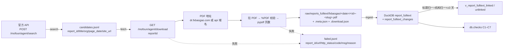

# 02 · 设计与实现（WORK-623，官方 API）

## 1. 数据流

全部在 Mo-server 执行，无浏览器、无桌面依赖。

## 2. 采集口径

| 步骤 | 实现 |
|---|---|
| 鉴权 | 只读 `/srv/share/quantdb/secrets/fxbaogao_api_key`（单行、600、目录 700）；日志只写 sha256 前 8 位 |
| 成功判定 | HTTP 200 且 `body.code ∈ {0,200}`；否则失败（**不看 HTTP 200 就当成功**） |
| 搜索 | `pageNum` 1–10；超出直接报错（不翻页，按官方要求改检索条件）；每页原始回包落 `search_raw/pageN.json` |
| 取地址 | `GET /mofoun/agent/download?reportId=`，递归找 `pdfUrl/url/fileUrl/downloadUrl`；相对路径拼 `dr.fxbaogao.com` |
| 拉 PDF | 仅当地址在 `api.fxbaogao.com` 时才带 Authorization；`Accept: application/pdf,*/*`；二进制不经 utf-8 解码 |
| 落盘 | `<page_date>/<report_id>-<slug>.pdf` + `.meta.json` + `.download.json`（download 原始回包，含额度字段证据） |
| 重复扣额度防护 | 同 id 已有 PDF 默认跳过；`--force` 才重下；单轮 `--limit` 默认 5 |
| 同 id 换名 | 新文件落盘后清理同日期目录层内的旧 `<id>-*.pdf/.meta.json/.download.json`（不动 `_inbox/`） |
| 节流/台账 | 复用 `scripts/work537_probe.py`：同域 ≥1.05s（按完成时刻）、append 式 `request_ledger.json` |

## 3. 选型与排除

| 决策点 | 候选 | 选中 | 排除理由 |
|---|---|---|---|
| 接入方式 | ① 官方 HTTP API；② 官方 CLI 发布包；③ MCP（在线/uvx）；④ 浏览器自动化 | ① | ② 多一层外部二进制与版本漂移，批量幂等仍要自己写；③ MCP 面向对话型 Agent，批处理、重试、落盘与失败台账都不受控；④ 契约变更 01 作废，且本机碰不到桌面登录态 |
| token 存放 | ① secrets 文件；② 环境变量；③ 配置入库 | ① | ② 易进 shell 历史/进程环境；③ 仓库 public，直接违规 |
| 成败判定 | ① 只看 HTTP 状态；② 看 `code` | ② | ① 实测业务错误返回 HTTP 200 + code=300011，会把失败当成功入库 |
| PDF 地址来源 | ① 文档未给具体字段；② 官方 MCP 的递归字段表 | ② | ① 无法实现；② 官方实现就是按 `pdfUrl/url/fileUrl/downloadUrl` 递归找，相对路径拼 `dr.fxbaogao.com` |
| 重复下载 | ① 每次全量重下；② 已存在即跳过 | ② | ① 每篇都扣权益；② 需要重下时用 `--force` 显式承担 |
| 关联匹配 | ① 严格标题+机构+±3 天；② 模糊相似度 | ① | ② 68,874 条里同机构同周同名概率不低，误配不可解释；① 漏配可解释（`v_report_fulltext_unlinked`） |

## 4. 表与视图

`report_fulltext`（PK `report_id`）：`title / org_name / publish_date / page_url / site_url / pdf_url / pdf_path / pdf_bytes / pdf_pages / sha256 / fetched_at / fetch_mode / meta_path / ingested_at`。
`site_url` 固定 `https://www.fxbaogao.com/view?id=<id>`（官方要求保留回查链接），meta 缺失时入库按 id 补齐。

`report_fulltext_changes`：同 id 的 sha256 变化追加一行（`old_sha256/new_sha256/reason=sha256_changed`）。

视图：`v_report_fulltext`、`v_report_fulltext_link_candidates`、`v_report_fulltext_linked`、`v_report_fulltext_unlinked`；归一化只在 SQL 宏（`fx_norm_title/fx_norm_org`）。

## 5. 失败与重试

* 单篇失败只写 `failed.jsonl` 并继续；字段：`report_id / url / http_status / code / msg / reason / path / ts`。
* 无 token：`check-auth/search/fetch` 退出码 3，不发任何请求。
* `download` 返回里没有 PDF 地址 → 记 `quota_suspect`，保留原始 `code/msg`，不猜额度数值。
* PDF 非 `%PDF` 或页数 0 → 失败，不写 meta、不入库。
* 不做自动重试（避免重复扣额度）；同一批重跑靠「已存在跳过」实现幂等。

## 6. 文件清单

| 文件 | 作用 |
|---|---|
| `scripts/fxbaogao_fulltext.py` | 采集器：check-auth / search / fetch / verify |
| `scripts/work537_probe.py` | HTTP 基础：`http_request`（GET/POST/二进制）、节流、台账、robots |
| `db/schema_report_fulltext.sql` | 表、留痕表、4 视图、归一化宏、旧表补列 |
| `db/etl/report_fulltext.py` | ingest（幂等入库） |
| `db/checks/report_fulltext.py` | C1–C7 对账闸 |
| `db/tests/test_work623_api.py` | 采集器离线测试（22 条，FakeProbe） |
| `db/tests/test_report_fulltext.py` | 入库/视图/闸门离线测试（18 条） |
| `docs/WORK-623/` | 可行性、设计、跑法、验收、交付页 |
