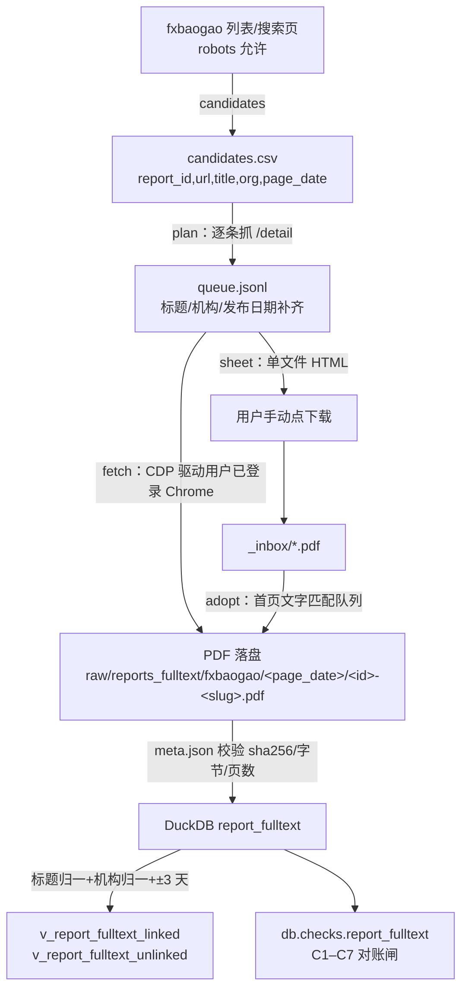

# 02 · 设计与实现（WORK-623）

## 1. 数据流



采集与入库**分机、分进程**：

| 阶段 | 主机 | 命令 | 写什么 |
|---|---|---|---|
| 采集 | DESKTOP-TS1FCDR（登录态所在） | `scripts/fxbaogao_fulltext.py fetch` | PDF + meta.json + failed.jsonl |
| 手工兜底 | 用户桌面（任何浏览器） | 打开 `sheet.html` 点下载 → 放 `_inbox/` | 原始 PDF |
| 收编 | Mo-server | `python -m db.etl.report_fulltext adopt` | 规范目录 + meta.json |
| 入库 | Mo-server（ETL 单写） | `python -m db.etl.report_fulltext ingest` | `report_fulltext`、`report_fulltext_changes` |
| 对账 | Mo-server（只读） | `python -m db.checks.report_fulltext all` | `meta/checks/report_fulltext.json` |

## 2. 落盘契约

```
/srv/share/quantdb/raw/reports_fulltext/fxbaogao/
├── 2026-11-16/
│   ├── 5884540-艾奇在线-2026中国教育行业GEO与SEO优化研究报告.pdf
│   └── 5884540-艾奇在线-2026中国教育行业GEO与SEO优化研究报告.meta.json
├── _inbox/            # 手工下载暂存，adopt 收编后清空
├── _partial/          # 下载中的 .pdf.part，失败可留证
├── _diagnostics/      # 找不到下载控件时的页面快照
├── failed.jsonl       # 失败台账（追加）
└── unmatched.jsonl    # adopt 未匹配台账（追加）
```

`meta.json` 字段（验收标准 2 要求的最小集在前 10 项）：

| 字段 | 含义 |
|---|---|
| `report_id` | 发现报告 detail 数字 id（唯一键） |
| `title` | 详情页 `og:title` 原文（含「-发现报告」后缀） |
| `org` | 机构（页面 `keywords` 首项；缺失时退到标题冒号前） |
| `page_date` | `article:published_time` 的日期（CST） |
| `source_url` | 详情页 URL（不是 `/pdf`） |
| `bytes` | PDF 字节数 |
| `pages` | pypdf 实读页数（必须 > 0） |
| `sha256` | PDF 文件哈希 |
| `fetched_at` | ISO8601 带时区 |
| `fetch_mode` | `cdp` / `manual` / `synthetic-demo` |
| `channel_id` / `http_status` / `robots_rule` | 渠道与证据字段 |

## 3. 唯一键与幂等

* 唯一键 `report_id`：同 id 重抓 `INSERT OR REPLACE`，行数不增。
* sha256 变化：先写 `report_fulltext_changes`（old/new/时间/原因 `sha256_changed`），再覆盖正文行 —— 内容变了能看出来。
* ingest 每次全量扫描目录：新增=inserted，同 sha=unchanged，异 sha=updated，校验不过=failed。

## 4. 与 report_meta 的关联（口径写死在 SQL 宏）

```
标题归一：去结尾「发现报告/报告网」→ 去全部标点空白并小写 → 去掉开头机构名
           （先试整串机构，再试去「股份有限公司/有限责任公司/有限公司」的简称）
机构归一：去公司后缀（集团）？(股份有限公司|有限责任公司|有限公司)$ → 去标点空白小写
关联条件：标题归一相等 AND 机构归一相等 AND |发布日差| ≤ 3 天
多候选：日差最小优先，其次 info_code 最小（确定性）；candidate_count 暴露歧义
```

归一化只有一份实现：`db/schema_report_fulltext.sql` 的 `fx_norm_title/fx_norm_org` 宏。入库脚本不另算一份，避免两处口径漂移。

## 5. 选型与排除理由

| 决策点 | 候选 | 选中 | 排除理由 |
|---|---|---|---|
| PDF 获取方式 | ① 裸 HTTP + cookie 直取 `/pdf`；② Playwright 独立浏览器 + cookie 文件；③ CDP 复用用户已登录 Chrome；④ 纯手工清单 | ③ 主路径 + ④ 兜底 | ① 违反 robots `Disallow: /pdf`，且等于自建爬虫；② 要复制登录态、易触发异地/多设备风控，且仍是自动化请求 `/pdf`；③ 不接触账号密码，下载由用户自己的浏览器发起；④ 无登录态/自动化被风控时唯一合规路径 |
| 页面共享代码 | ① 复制 work537 的节流/robots/台账；② importlib 复用 `scripts/work537_probe.py`；③ 新建框架 | ② | ① 两份实现必然漂移；③ 与「不新造爬虫框架」冲突 |
| 下载控件识别 | ① 默认把 `a[href^="/pdf"]` 当第一个候选；② 只认「下载」类控件，点击前校验 href | ② | ① 会让浏览器自动请求 robots 禁止的 `/pdf`，等于自己破规则；② 违规路径直接判失败并提示手点 |
| 归一化实现 | ① Python 算好存列；② SQL 宏两侧共用 | ② | ① 入库脚本与视图各算一份，口径会漂；② 只有一个定义 |
| PDF 页数 | ① pypdf；② pdfminer.six；③ 调 `pdfinfo` | ① | ② 依赖更重、无额外收益；③ 需要 poppler 外部二进制，Windows 上还要另装 |
| 入库触发 | ① 扫描目录幂等重跑；② 采集端推送 API | ① | ② 多一个服务与失败面；① 天然支持补传、重跑、离线校验 |
| 关联匹配 | ① 严格相等（标题+机构+±3 天）；② 模糊相似度 | ① | ② 68,874 条里同机构同周多篇同名报告概率不低，模糊匹配会产生无法解释的误配；① 漏配可解释（`v_report_fulltext_unlinked`），误配不可解释 |
| 页数/字节/哈希校验 | ① 信任 meta；② 入库时按磁盘重算 | ② | ① 手工拷贝、半截下载、同名覆盖都会让 meta 与文件脱节 |

## 6. 失败与风控

* 单篇失败只写 `failed.jsonl` 并继续；整批失败率不阻断其余条目。
* 登录态不是高级 VIP → 整批停（退出码 3），写 `login_state.json`，不逐篇重试。
* 找不到下载控件 → 页面快照落 `_diagnostics/<id>.html`，reason 里带路径，供下一轮补选择器。
* 下载到非 PDF（登录页/错误页）→ `PDF 校验失败`，不写 meta、不入库。
* 出现验证码/异常登录提示 → 停手，按交付说明回报（本单未触发：未登录）。
* 请求节流：同域名 ≥1.05 s（复用 work537 的 `_throttle`，按请求**完成**时刻计），单轮 `--max-requests` 默认 200。
* 同 id 重抓若标题/页面日期变化导致换文件名：写入成功后清理 `*/<report_id>-*.pdf` 旧文件与旧 meta，保证「一篇报告一份磁盘文件」。
* 台账目录按 `LEDGER_PATH` 的真实父目录创建；落盘根可用 `FXBAOGAO_ROOT` 覆盖（Windows 上避免 POSIX 路径解析到 `C:\srv\...`）。
* `meta.json` 顶层必须是对象、数值字段容错解析：坏值写 `failed.jsonl` 而不是让整批 traceback（C5 同样捕获）。

## 7. 文件清单

| 文件 | 作用 |
|---|---|
| `scripts/fxbaogao_fulltext.py` | 采集器：candidates / plan / fetch / sheet / verify / robots |
| `scripts/work537_probe.py` | 复用面 + 新增 `fxbaogao_vip` 渠道登记（默认 probe 跳过 `*_vip`） |
| `db/schema_report_fulltext.sql` | 表、留痕表、4 个视图、归一化宏 |
| `db/etl/report_fulltext.py` | ingest / adopt / schema 子命令 |
| `db/checks/report_fulltext.py` | C1–C7 对账闸 |
| `db/tests/test_report_fulltext.py` | 入库/视图/闸门离线测试（17 条） |
| `db/tests/test_work623_collector.py` | 采集器离线测试（17 条） |
| `docs/WORK-623/` | 本目录：可行性、设计、跑法、验收、交付 |
