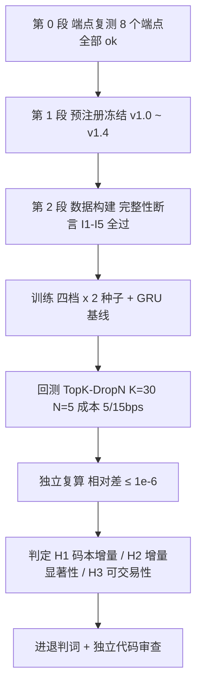

## 交付：PRISM-VQ（arXiv:2605.13407v1）在 A 股 CSI300 上的四档消融复现

### 一句话判词（两条结论方向相反，必须分开读）

**H1（主检验量，码本有没有增量）：「进：码本有效性复现成立」**
—— Δ_drop = -21.6%，落在 [−40%,−15%]「进」带；论文同口径 -26.9%。
**⇒ 「离散码本确实带来了增量」这一条，复现成立。**

**顶层判词（整体）：「退：净 SR < 0（与 H1 无关，直接判退）」**
—— 按预注册，H3 的「净 SR < 0 直接判退」是一条**独立于 H1 的硬规则**：
本单净 SR 中位数 -0.433 < 0（负值），该规则触发，把整体判词改写成「退：净 SR < 0（与 H1 无关，直接判退）」。
**⇒ 「按预注册的组合口径（只做多 + 日频调仓 + 买 5/卖 15 bps）能赚钱」这一条，复现不成立。**

**这两句不矛盾**：码本的增量是真的，但预注册口径下的交易摩擦把它吃光了——见下面第 4 条（预注册外零成本诊断：毛口径对指数超额年化 +6.7 % / +10.3 %，成本拖累 ≈8.4 %/年）。
本结论为内部研究模拟，**不构成投资建议、不构成任何推荐或收益承诺**。

### 三条依据

1. **H1（主检验量，码本有没有增量）**：完整模型 RankIC 中位数 **0.0678**，
   去码本档 **0.0531**，Δ_drop = -21.6%（落在 [−40%,−15%]「进」带）；
   逐种子 Δ_drop = 42: -17.6%, 2024: -25.7%（两个种子**都在同一带内**）。
   论文 Table 2 同口径 = -26.9%（字面式 Δ_formula = +26.9%，本单字面式 +21.6%）。
   ⇒ **H1 判词：进：码本有效性复现成立**。
2. **H2（相对固定基线 GRU 的增量显著性，10000 次 block bootstrap，block=5 日）**：
   种子 42：差值 0.0088，95% CI [-0.0034, 0.0217]（含 0 → 增量不可证，与论文自曝弱点一致）；种子 2024：差值 0.0134，95% CI [-0.0023, 0.0286]（含 0 → 增量不可证，与论文自曝弱点一致）。
3. **H3（可交易性）**：净 SR 中位数 **-0.433**（论文 1.5694），
   CI 下界最小值 -1.648，相对论文比值 -0.276（下限 0.40），
   判定为 **可交易性不成立**；净 SR < 0 直接判退一条命中。
4. **预注册外诊断 · 零成本**：把成本置零后同一组合对 CSI300 指数的年化超额为 **+6.70 %（种子 42）/ +10.25 %（种子 2024）**，
   日均单边换手 0.1667 对应成本拖累 ≈3.3 bps/日 ≈8.4 %/年 ⇒ **信号本身有正超额，但被预注册口径的换手成本吃光**。
   三档预注册成本下净 SR 全为负：8 bps −0.442 / −0.229；30 bps −0.792 / −0.565。

### 四档消融 × 2 个种子（测试段 2022-01-04 ~ 2024-12-31）

| 档 | RankIC 种子42 | RankIC 种子2024 | SR 种子42 | SR 种子2024 | RankICIR 均值 | MDD 均值 | 单边换手均值 |
|---|---|---|---|---|---|---|---|
| 完整模型 | 0.0676 | 0.0680 | -0.542 | -0.325 | 0.3660 | 0.3602 | 0.167 |
| 去码本 | 0.0557 | 0.0505 | -0.482 | -0.519 | 0.3913 | 0.3491 | 0.167 |
| 去 MoE | 0.0701 | 0.0664 | -0.293 | -0.161 | 0.3715 | 0.3119 | 0.167 |
| 去先验 | 0.0552 | 0.0665 | -0.376 | -0.371 | 0.3509 | 0.3381 | 0.167 |
| GRU 基线 | 0.0588 | 0.0545 | -0.514 | -0.918 | 0.3706 | 0.4434 | 0.167 |

逐种子全量指标（含基准调整 alpha、持仓数、换手）见 `metrics_table.csv`；
按档聚合的 mean ± range 见 `metrics_by_arm.csv`；机器可读总表见 `backtest_results.json`。

### H2 / H3 明细

| 种子 | RankIC(full) | RankIC(GRU) | 差值 | 95% CI | CI 是否含 0 |
|---|---|---|---|---|---|
| 42 | 0.0676 | 0.0588 | 0.0088 | [-0.0034, 0.0217] | 含 0（增量不可证） |
| 2024 | 0.0680 | 0.0545 | 0.0134 | [-0.0023, 0.0286] | 含 0（增量不可证） |

| 种子 | 净 SR | SR 95% CI | 年化 AR | MDD | 单边换手 | CSI300指数基准超额(年化) | 等权基准超额(年化) | 总市值篮子超额(年化) |
|---|---|---|---|---|---|---|---|---|
| 42 | -0.542 | [-1.648, 0.670] | -0.0871 | 0.3547 | 0.167 | -0.0170 | -0.0071 | -0.1233 |
| 2024 | -0.325 | [-1.467, 0.910] | -0.0553 | 0.3656 | 0.167 | 0.0184 | 0.0283 | -0.0878 |

### 端点实测（第 0 段，8 个端点）

| # | 端点类别 | 工具 | 返回行数 | 覆盖起止 | 状态 |
|---|---|---|---|---|---|
| E1 | 日频个股 bar（开高低收 + 复权因子 + 成交量 + 成交额） | `mcp__tushare__daily` | 7 | 2024-01-02 ~ 2024-01-10 | ok |
| E2 | 日频个股 bar — 复权因子 | `mcp__tushare__adj_factor` | 7 | 2024-01-02 ~ 2024-01-10 | ok |
| E3 | 涨跌停价 / 涨跌停标记 + 估值 + 换手率（掩码与先验因子用） | `mcp__tushare__daily_basic` | 7 | 2024-01-02 ~ 2024-01-10 | ok |
| E4 | point-in-time 指数成分与权重（CSI300） | `mcp__tushare__index_weight` | 1 | 2024-01-31 ~ 2024-01-31 | ok |
| E5 | 停牌标记（掩码用） | `mcp__tushare__suspend_d` | 34 | 2023-04-24 ~ 2023-07-06 | ok |
| E6 | 退市股名录（幸存者偏差体检用） | `mcp__tushare__stock_basic` | 330 | 1993-03-16 (最早 list_date) ~ 2026-11-13 (最晚 delist_date) | ok |
| E7 | 基准指数日频（CSI300，基准调整 alpha 用） | `mcp__tushare__index_daily` | 7 | 2024-01-02 ~ 2024-01-10 | ok |
| E8 | 交易日历 | `mcp__tushare__trade_cal` | 31 | 2024-01-01 ~ 2024-01-31 | ok |

未取到：JKP 全球因子库 13 因子（A 股逐股覆盖）；Level-2/3 逐笔、付费终端、另类数据。
完整原文：`experiments/WORK-503/data_probe.json`。

### 独立复算

- 脚本：`audit/recompute_work503.py`（**不 import 建模阶段任何函数**，`ast` 机械自检结果
  `modeling_imports_found = 0`）；与建模侧逐项相对差 ≤ 1e-6，
  **不一致 0 处**。
- 产物：`experiments/WORK-503/audit_recompute.json`。
- 偏离披露：该脚本用了 numpy/pandas/scipy（快照是 parquet，标准库无 parquet 读取器），已写进产物的 `independence` 字段。

### 数据完整性与前视

- 断言 I1–I5：**全部通过**；
  测试段可交易率 0.9508、有行情行占比 0.9994、
  PIT 成分覆盖率 0.9994。
- 前视检查：特征轴 2742825 值最大差 1.9268062514399276e-06；
  先验轴 1971865 值最大差 2.799620782756307e-06；
  标签轴 125 值最大差 3.7194826107977974e-09；日期错配 0 处。

### 掩码断言确实在跑（故意违规触发原文）

- `experiments/WORK-503/assertion_violation.txt`（涨停不可买）
- `experiments/WORK-503/assertion_violation_weight.txt`（组合权重 / 账本不变量）

### 预注册（先于回测产物）

- 最终生效版本 **v1.4**，commit **2406fde**（2026-11-22T15:09:37+08:00）；
  其中 **v1.3（commit c10403a）冻结了主检验量的符号口径**，v1.4 更正 v1.3 §4 的错误论证（两者都早于任何正式回测产物）。
- 历史版本 v1.0 / v1.1 / v1.2 全部保留在 `experiments/WORK-503/preregistration*.md`。
- **v1.3 / v1.4 的唯一实质变更**：主检验量的符号口径。派单卡的公式、论文基准「−26.9%」、进带 [−40%,−15%] 三句互相矛盾
  （按字面公式代入论文数字得 +26.9%，落不进进带）；本单冻结为 Δ_drop = (RankIC_no_vq − RankIC_full)/RankIC_full，
  **判词带逐字不动**，并并列报告字面式 Δ_formula。该修订在正式训练跑完之前完成，判词带的数字一次都没变过。
- 失败判据命中：无。

### 可复现性（同种子独立重跑）

- 同一 arm、同一 seed、同一 commit 的**第二次独立训练**（`--out-suffix _repro`，正式产物不被覆盖，用时 455.7 s）：
  两份 parquet 的 **sha256 完全相同**、**逐格比较 0 处不一致**、`max abs diff = 0.0`。
- 产物：`experiments/WORK-503/reproducibility_check.json`（字节 sha256 与逐格精确比较同时记录）。

### 交付物清单（12 项）

| # | 交付物 | 位置 | 状态 |
|---|---|---|---|
| 1 | 端点实测 | `experiments/WORK-503/data_probe.json` | 已交付 |
| 2 | 预注册 + commit sha | `experiments/WORK-503/preregistration_v1.4.md`（2406fde） | 已交付 |
| 3 | 快照 manifest | `experiments/WORK-503/snapshot_manifest*.json` | 已交付 |
| 4 | 代码 + 断言触发原文 | `experiments/WORK-503/assertion_violation*.txt` | 已交付 |
| 5 | 四档 × 2 种子指标表 | `experiments/WORK-503/metrics_table.csv` / `metrics_by_arm.csv` / `backtest_results.json` | 已交付 |
| 6 | 独立复算结果 | `experiments/WORK-503/audit_recompute.json`（0 处不一致） | 已交付 |
| 7 | 与论文对照表 | `experiments/WORK-503/paper_comparison.csv` | 已交付 |
| 8 | 基准调整 alpha（三口径并列） | CSI300 指数 / PIT 等权 / PIT 总市值篮子，见上表与 `backtest_results.json` | 已交付 |
| 9 | 进 / 退判词（H1 与顶层分别给） | 本评论首段 + `verdict.json` | 已交付 |
| 10 | 单文件 HTML 报告 + 首屏 PNG + 打印 PDF | `experiments/WORK-503/report.html` / `preview_first_screen.png` / `report_print.pdf` | 已交付 |
| 11 | 实验登记 | `experiments/registry.md`（WORK-503 行） | 已交付 |
| 12 | 失败记录 | `experiments/WORK-503/failure_log.md` | 已交付 |

附带：`cost_sensitivity.csv`（三档预注册成本 + 零成本诊断）、`reproducibility_check.json`（同种子 sha256）、`lookahead_check.json`（三轴前视抽查）。

代码提交：HEAD `52f0111`（52f01119dd5726990641326aefcf223f89858fff）。

### 第二轮独立代码审查（子代理 verifier）

- **结论：PASS —— 无 blocking。** 审查方未修改任何被审文件（复跑前后对 11,263 个文件取 sha256 清单逐一比对，复跑产物已原样还原）。
- 独立复算重跑 **0 处不一致**（70/70 字段与已提交产物完全一致）、`independence.modeling_imports_found = 0`；
  判定脚本重跑**字节级一致**；边界单测 **26 项全过**；四张图碰撞审计全 PASS；
  `report.html` 外链 0 处、PNG 1440×900、PDF A4 纵向；报告正文 **235 个十进制数值全部可回溯**到产物。
- 审查方手算 H1 / H3 / 换手 / 基准四项，**相对差均为 0.000e+00**。
- 报出 **5 条 suggestion + 6 条 nit**，本单已逐条处理并写进 `failure_log.md` §13.1：
  ① 摘要原引用**已被 v1.4 撤回**的 v1.3 §4 → 改引 v1.3 §3 + v1.4 §2；
  ② 「相对差 ≤ 6.6e-15」是**只针对 MDD** 的量 → 改为实测「MDD ≤ 5.7e-15、全指标最大 2.4e-14」；
  ③ 失败判据 4 原为**硬编码 `hit: False`** → 改为用 `git log` **实算**（预注册 15:09:37 < 第一个回测产物 17:12:24 → 未命中）；
  ④ 单测 T4 原读**自己的源码**（恒真）→ 改扫判定脚本；
  ⑤ 历史「71/121 点」与 commit message 的不精确 → **两个数并列披露**，不替历史挑版本。
- 审查方明确列为**未验证**的项（训练侧正确性、逐位复现性的本轮实跑、论文换手口径、I1/I2/I4 抽样充分性等），
  本单照原样标「未验证」，**不写成「通过」**。

### 失败项与已知限制（不藏）

- 训练前的数据完整性审计发现并修复了 5 处数据构造层缺陷；修复前的产物全部作废。
- 第一轮 stage-1 因上游 `wandb.log` 未初始化崩溃；第二轮 stage-1 因**未播种全局 RNG** 作废（种子只是标签）。
- 独立代码审查（子代理）报出 2 条 blocking（判词带符号矛盾、判定脚本必崩），均在正式结果产生前修完。
- 审查同时暴露了本单自己的一处错误论证（预注册 v1.3 §4），被落盘后立刻补的边界单测当场判红，已由 v1.4 更正。
- **终稿跑数阶段由流水线自己抓出的 3 个实现 bug**（详见 `failure_log.md` §11，全部带修前/修后测量值，判词均未因此翻转）：
  ① MDD 的运行峰值漏算初始资金 → 独立复算报 9 处不一致 → 修后 **0 处**；
  ② H2 的逐日 RankIC 序列未按日期对齐 → 判定脚本直接崩 → 修后 join 726 天、`mean_full` 与回测 RankIC 逐位相同；
  ③ PIT 覆盖率的**分母**写成宇宙笛卡尔积（算出 0.414，会误判「数据不可用、停手」）→ 修后 **0.9994** ≥ 0.90。
- **GRU 基线脚本有 3 个 bug**（qlib 的 `GRU` 是包装类不是 `nn.Module`；`d_model`/`n_layers` 被 `**kwargs` 静默吞掉；取标签时把行号当键对用）——基线此前一次都没成功跑过，修完才拿到数。
- **「市值加权基准」原实现有缺陷**（退化成总市值加权）：篮子 +9.46 % vs 指数 −19.99 %，日收益相关 0.98、累计差 30 pp → 主口径改用真实 CSI300 指数，自建篮子降为并列口径，阈值未动。
- **上游仓库不含组合构造 / 回测代码**（只有 `utils/metric.py` 的指标公式，其 AR 年化为 log×252，与本单 exp−1 略异）→ 论文的长/多空与成本假设**无法从代码核实**，报告写「未取到」，不猜。
- 算力约束：本机无 GPU，训练段 2015–2019（论文 2009–2019）、每阶段 ≤6 轮（论文 ≤50）→ 绝对指标系统性低于论文，
  **只比较四档之间的相对差**。
- 先验替换：JKP 13 因子无 A 股个股级对应值，自建 6 因子 → `no_prior` 档的降幅**不能**用来支持「码本有效」。
- 完整清单见 `experiments/WORK-503/failure_log.md`。

### 声明

本报告为内部研究模拟，撰写方非持牌机构，**不构成投资建议、不构成任何推荐或收益承诺**。
