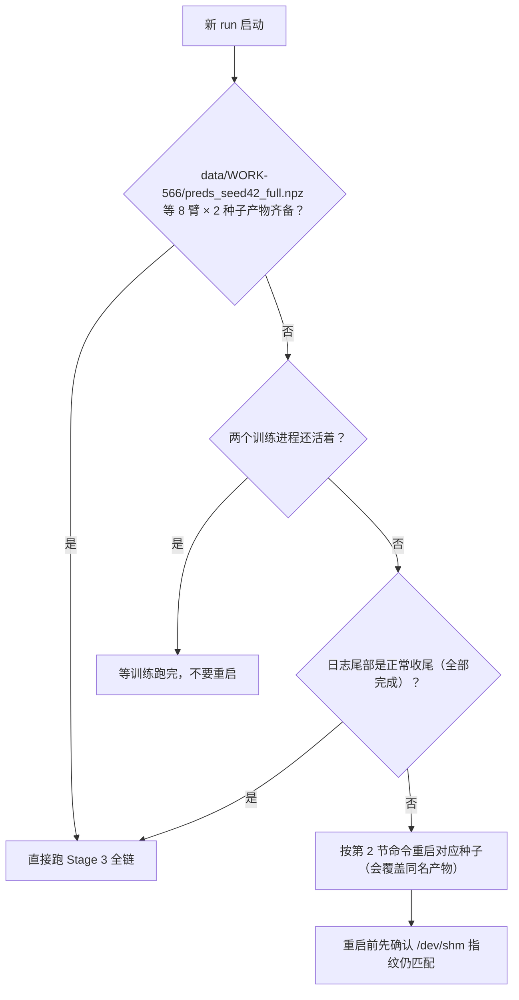

# WORK-566 运行状态与续跑指引

> 最后更新：2026-11-25 16:10（本次 run）
> 用途：本机已发生 **两次 `daemon shut down while task was in flight`**（task
> `01a2108c-32ee-7c26-92f4-b972df64b46a`、`01a21099-f7b1-79f9-8fa2-e0a29716dad1`）。
> 任何一次 run 被平台中断后，**先读本文件**再决定续跑动作，不要重新规划。

---

## 1. 当前进度（截至最后一次更新）

| 阶段 | 状态 | 产物 / 证据 |
|---|---|---|
| Stage 0 端点复测 | ✅ DONE | `experiments/WORK-566/data_probe.json` |
| 论文原文核对 | ✅ DONE | `work/paper/paper.txt`（2069 行） |
| Stage 1 预注册 v1.0 | ✅ DONE | commit `16b24fb` |
| Stage 1 预注册 v1.1 | ✅ DONE | commit `7580a3d`（**早于**首个回测产物 `a3d8b88`） |
| Stage 2a 面板 / 先验 / 样本 | ✅ DONE | `data/WORK-566/{feat.npy,targets.npy,prior.json,norm.json,samples.npz}` |
| Stage 2b FMB 基线 | ✅ DONE | RankIC **9.377620%**（论文 8.76%） |
| 审查第 1 轮 | ✅ FAIL→整改 | `code_review_work566.md` |
| 审查第 2 轮 | ✅ 判 B2→已修 | commit `686b921` |
| **Stage 2c 正式训练（2 种子）** | 🔄 **运行中** | 日志 `/tmp/w566_s42.log`、`/tmp/w566_s2024.log` |
| 审查第 3 轮 | 🔄 运行中 | 子代理任务 `bg_c68840f6` |
| Stage 3 全链 | ⏳ 未开始 | `scripts/work566_run_stage3.sh` |

## 2. 训练命令（已验证可跑通）

> ⚠️ **必须「一个种子一个种子」顺序跑**，不要两个种子同时跑。
> 2026-11-25 16:17 双进程并行触发了**整机 OOM**：内核杀了我们的训练进程**和**
> `multica-daemon.service`（平台提示里的 `daemon shut down while task was in flight`
> 就是 OOM 的次生结果，不是平台故障）。取证见 `failure_log.md` §13。
> 双进程硬占用 = 1.4 GB×2（anon）+ 1.4 GB（tmpfs）= 4.2 GB，而本机 swap 已满、
> 同机他人 tmpfs 另占 2.3 GB。顺序跑把硬占用降到 2.8 GB，总墙钟时间不变
> （本单训练是计算受限，不是 I/O 受限）。

```bash
cd /srv/data/multica/workspaces/workspace-c8faa36a018a/work-566-e0a29716dad1/workdir/quant-lab
MALLOC_ARENA_MAX=2 setsid nohup ../.venv/bin/python -u scripts/work566_train.py \
    --seeds 42 --threads 6 --rep-batch 1024 > /tmp/w566_s42.log 2>&1 < /dev/null &
# 等 seed42 的日志出现「全部完成」后，再起 seed2024（同样命令，把 --seeds 换成 2024）
```

**内存看门狗**（每次起训练都挂上，OOM 前兆可回溯）：
```bash
setsid nohup /tmp/w566_memwatch.sh > /tmp/w566_mem.log 2>&1 < /dev/null &
```
关键字段：`avail`（MemAvailable，低于 ~500 MB 即在危险区）、`swapfree`（本机长期为 0）、
`shmem`（tmpfs 合计，本单占 1.4 GB）、`trainRSS`（训练进程常驻内存）。

- **用 `setsid nohup ... &` 启动**：脱离当前会话，平台 daemon 重启**不会**打断训练。
- 其余参数**全部取默认值**，与预注册 §8 的算力降级表一一对应，不得改动：
  `batch 256 / epochs 4 / max-updates 1000 / readout-epochs 6 / readout-max-updates 1000 /
  stock-cap 1000 / val-stride 4 / val-batch 512`。
- 实测速率：两个种子并行各 **1.23–1.24 upd/s**（4 线程）；seed42 的
  `L_anc/L_rev` 与上一轮日志**逐位一致**（确定性复现成立）。
- **不要用 `pkill -f`**：只按确切 PID kill（见 failure_log §8.2 / §11.6）。

## 3. tmpfs 前置条件（训练会自己处理，但要知道代价）

- 训练随机取数依赖 `/dev/shm/w566_feat_train.npy`（5783 × 1586 × 40，**1400MB**），
  旁边有指纹 sidecar `/dev/shm/w566_feat_train.npy.fp`（内容 = 源 `feat.npy` 的 `size:mtime`）。
- 复用条件：**shape + 起日 + 指纹**三者全对上。面板重建后指纹会变 → 自动重建（约 265s）。
- 重建时峰值 tmpfs = 旧 1.4GB + 新 1.4GB ≈ 2.8GB。本机 `MemAvailable` 常在 0.9–2.9GB 波动、
  **swap 常满**，重建期间有 OOM 风险。若训练进程突然消失且日志无正常收尾，先查是不是被 OOM 杀了。

## 4. 续跑决策树



- 产物齐备的判定（两个种子 × 8 臂）：
  `data/WORK-566/preds_seed{42,2024}_{s1_only,s3_only,s1_s2,full,r0,r1,r2,r3}.npz`
  **全部 16 个文件存在**且 `npz` 内 `pred_test` 长度 = 测试样本数（seed42 应为 2,949,469）。
- 训练**没有断点续跑**：中途被杀就要从头跑该种子。

## 5. Stage 3（训练完成后）

```bash
cd /srv/data/multica/workspaces/workspace-c8faa36a018a/work-566-e0a29716dad1/workdir/quant-lab
bash scripts/work566_run_stage3.sh          # JOBS=3 可调并行度
```

七步：组合回测（9 臂 × 2 种子 × 3 成本 = 54 次）→ 主检验与判词 → 独立复算（`audit/`）→
单文件 HTML 报告 → 渲染（1440×900 首屏 PNG + A4 PDF）→ 快照 manifest → **交付物自检（C1–C8）**。

- **交付物自检**：`scripts/work566_delivery_check.py`（已接入链尾）核验
  C1 16 个臂×种子预测产物齐备且 test 长度正确 / C2 关键产物齐备 / C3 独立复算 BLOCKING=0 /
  C4 H1 判词与预注册阈值一致 / C5 报告 HTML 单文件（无外链、无本地引用）/
  C6 1440×900 PNG + A4 PDF / C7 registry 与评论正文无占位符 / C8 预注册 commit 早于首个回测产物 commit。
  产物 `experiments/WORK-566/delivery_check.json`。
- **独立复算不 import 建模阶段任何函数**（预注册硬约束，已核：只 import stdlib + numpy + duckdb），
  相对差 ≤1e-6 才算一致。
- 判词阈值写死在 `scripts/work566_primary_test.py`：
  ΔRankIC **≥ +3.0pp = 进**；**≤ +1.0pp 或负 = 退**；**(1.0, 3.0) = 部分复现**；
  **种子数 < 2 → 判「未交付」**；H3 净 SR<0 直接判退。
- 收口前还要跑《估值规程》的三处数值勾稽与倍数翻转检验（只针对评级/目标价；本单不产出评级，
  但结论性表述仍需自洽）。

## 6. 收口清单（Stage 3 之后）

1. `bash scripts/work566_registry_row.py` → 写 `experiments/WORK-566/registry_row.md` 登记行
2. `../.venv/bin/python scripts/work566_comment.py` → 生成最终评论正文 `experiments/WORK-566/reply_body.md`
3. **平台评论命令（已核 `--help` 的硬约束）**：
   - `--content-file` 与 `--attachment` 的路径**必须位于当前工作目录内**（否则要加
     `--allow-external-file`）→ **在 `workdir/` 目录下执行**，用相对路径
     （如 `quant-lab/experiments/WORK-566/report.html`）。
   - `--parent` 对**触发式 run 是必填**（省略会被拒：只能回帖，不能发顶层评论）→ 用本轮触发评论
     `01a210a8-8277-7112-ba77-5db1f71859df`。
   - `--attachment` 一个 flag 一个路径，可重复。
   - `&&` 分开写（`add ... && rm ./reply.md` 会让清理成功掩盖发送失败）：

     ```bash
     cd <workdir>
     multica issue comment add 01a2108c-32e6-76b3-a1ea-c4f0ead6aede \
       --parent 01a210a8-8277-7112-ba77-5db1f71859df \
       --content-file ./reply.md \
       --attachment quant-lab/experiments/WORK-566/report.html \
       --attachment quant-lab/experiments/WORK-566/preview_first_screen.png \
       --attachment quant-lab/experiments/WORK-566/report_print.pdf \
       --output table
     rm ./reply.md
     ```
4. 交付物入库：`experiments/WORK-566/preview_first_screen.png`、`report_print.pdf`、
   `report_print_full.pdf`、单文件 HTML 报告、`snapshot_manifest.json`、
   `delivery_check.json`，以及**两个种子的训练日志**（`/tmp/w566_s42.log`、
   `/tmp/w566_s2024.log` → 复制进 `experiments/WORK-566/train_log_seed*.log`，
   `/tmp` 不耐重启，必须入库）
5. 每一段完成即 `git commit` + `git push`（不要攒到最后）
