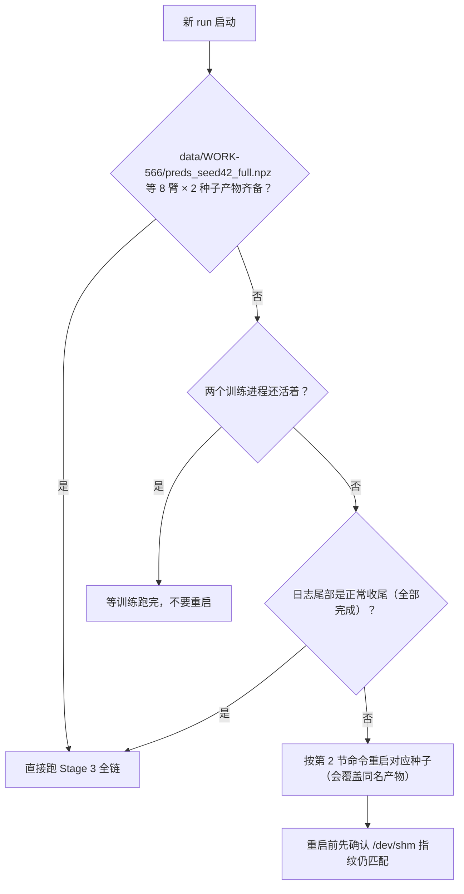

# WORK-566 运行状态与续跑指引

> 最后更新：2026-11-26 02:30（**交付完成**：双种子重训 + Stage 3 + 独立复算 + 报告/渲染 + 最终评论已发，issue 置 `in_review`）
> 用途：本机已发生 **两次 `daemon shut down while task was in flight`**（task
> `01a2108c-32ee-7c26-92f4-b972df64b46a`、`01a21099-f7b1-79f9-8fa2-e0a29716dad1`），
> 另有一次由**整机 OOM** 引起的同型记录（见 `failure_log.md` §13.1，内核日志可核对：
> `minio invoked oom-killer` → `Killed process … (python)` → `multica-daemon.service: Failed with result 'oom-kill'`）。
> 任何一次 run 被平台中断后，**先读本文件**再决定续跑动作，不要重新规划。

---

## 1. 当前进度（截至最后一次更新）

| 阶段 | 状态 | 产物 / 证据 |
|---|---|---|
| Stage 0 端点复测 | ✅ DONE | `experiments/WORK-566/data_probe.json` |
| 论文原文核对 | ✅ DONE | `work/paper/paper.txt`（2069 行） |
| Stage 1 预注册 v1.0 | ✅ DONE | commit `16b24fb` |
| Stage 1 预注册 v1.1 | ✅ DONE | commit `7580a3d`（**早于**首个回测产物 `a3d8b88`） |
| Stage 2a 面板 / 先验 / 样本 | ✅ DONE | `data/WORK-566/{feat.npy,targets.npy,prior.json,norm.json,samples.npz}` |
| Stage 2b FMB 基线 | ✅ DONE | RankIC **9.377620%**（论文 8.76%） |
| 审查第 1 轮 | ✅ FAIL→整改 | `code_review_work566.md` |
| 审查第 2 轮 | ✅ 判 B2→已修 | commit `686b921` |
| **审查第 3 轮（两位独立 verifier）** | ✅ **判 FAIL（B3/B4/B5 + 11 项 NB）→ 已全部整改** | `code_review_work566_round3.md`；`failure_log.md` §14 |
| **Stage 2c 正式训练（2 种子）** | ✅ **DONE**：seed42 23:23 完成、seed2024 02:01:53 完成（同一份 train.py sha256 `20b45a64…`） | 日志 `workdir/.w566tmp/w566_s{42,2024}_try1.log`；入库 `experiments/WORK-566/train_log_seed{42,2024}.log` |
| Stage 3 全链 | ✅ **DONE（02:05 重跑一次，02:17 完成）**：54 次回测 → H1/H2/H3/H4 → 独立复算 → 报告 → 渲染 → manifest → C1–C9 | `scripts/work566_run_stage3.sh`；**交付自检 PASS 9 / FAIL 0** |
| **收口守护（防平台打断）** | ✅ **已生效**：02:20 自动 commit `3fb86bd` + push + 发最终评论（带 3 附件） | `workdir/.w566tmp/w566_finalize.sh` |
| **最终评论（交付）** | ✅ **已发 2 条**：`01a213f0`（18:20:37Z 交付正文 + 3 附件）、`01a213f3`（18:24:05Z 勘误：审查轮次 3→4、H2 CI 改 4 位小数 + 修正后附件） | commit `15595af` |
| **判词** | **三段式增量复现成立**：H1 = ΔRankIC 跨种子中位数 **7.9153 pp**（种子 42：4.5083；种子 2024：11.3224）；论文基准 +6.07 pp | `verdict.json` / `metrics.json` |

### 1.0.1 本轮（2026-11-25 20:07 起）关键变更 —— 被打断后照此判断

| 时刻 | 事件 | 处置 / 证据 |
|---|---|---|
| 20:07 / 20:10 | 两次重跑「消失」，**真因是本单代码缺陷不是 OOM**：`warm_cache_range` 里 `arr.close()` 对 `numpy.memmap` 抛 `AttributeError` | `failure_log.md` §17；修复 commit `63f9e96`；回归测试 `scripts/work566_warm_cache_test.py` **7/7 PASS** |
| 20:25:14 | 修复后重跑 seed42（train.py sha256 `20b45a64…`，HEAD `63f9e96`） | 预热段通过（1066MB/23s），epoch0 验证损失 **115.0360**（与修复前那轮**逐位相同**） |
| 21:09–21:21 | **整机存储层停摆**（`kworker/u32:4+dm-thin` 卡死 26 分钟，全机 IO≈1.2MB/s），训练卡在周期快照写入 | `failure_log.md` §18；**未干预**用户自己的 `7z t` 备份校验作业；21:21 自行恢复 |
| 22:46 | seed42 表征训练完成：4000 updates / 8439s，**最优快照 vloss=115.0360（upd=1000，第 1 epoch）** | epoch1 137.2852 / epoch2 145.7438 / epoch3 151.0316 → 验证损失单调上升 |
| 22:46 | B3 修复的**盘上前后对照**：bug 版「epoch0」「epoch3」两文件**字节相同**（md5 `611d644a…`），修复版 md5 `c5d28fc5…` 且带 `selected=best_vloss`/`complete=True`/`cfg` | `failure_log.md` §17.6 |
| 23:23 | **seed42 全部完成**（8 臂 × 3 切分 preds 齐备，test 2,949,469 行） | `data/WORK-566/preds_seed42_*.npz` |
| 23:23:28 | seed2024 启动，**与 seed42 同一份 train.py sha256 `20b45a64…`** | `.w566tmp/w566_fullchain.log` |

> **重要**：seed42 与 seed2024 跑的是**同一份计算代码**（sha256 一致）；HEAD 差异只来自
> 中途只含文档的 commit（`8eccbee`、`6b40f29`），**不在任何计算路径上**。

### 1.1 为什么是「重跑」而不是「续跑」（2026-11-25 第 3 轮复审 B3）

- 原实现把 `Module.state_dict()` 直接存进 `best[1]` → **活引用**；优化器更新与 `ema_update`
  都是 in-place → `best[1]` 随训练推进而变；训练末尾又 `torch.save(best[1])` → **落盘的是最后一轮权重**，
  而不是预注册 §10.2 冻结的「验证损失最小者」。实测：落盘文件 `upd=1000`（best=epoch0）却带 epoch3 的 `m_k/v_k`。
- 影响方向：`s1_only` 不用表征（不受影响）、`full` 用（受影响）→ **系统性压低 ΔRankIC**。
- epoch0 权重**不可恢复**（`stale/ckpt_seed42_rep_epoch0.pt` 与 buggy 文件 md5 完全相同）。
- 处置：修实现 → **两个种子全部完整重训**；为保证两种子跑同一份代码，train.py 的改动在重启前一次性做完。

## 2. 训练命令（已验证可跑通）

> ⚠️ **必须「一个种子一个种子」顺序跑**，不要两个种子同时跑。
> 2026-11-25 16:17 双进程并行触发了**整机 OOM**：内核杀了我们的训练进程**和**
> `multica-daemon.service`（平台提示里的 `daemon shut down while task was in flight`
> 就是 OOM 的次生结果，不是平台故障）。取证见 `failure_log.md` §13。
> 双进程硬占用 = 1.4 GB×2（anon）+ 1.4 GB（tmpfs）= 4.2 GB，而本机 swap 已满、
> 同机他人 tmpfs 另占 2.3 GB。顺序跑把硬占用降到 2.8 GB，总墙钟时间不变
> （本单训练是计算受限，不是 I/O 受限）。

**当前用的是一条全链守护**（seed42 → seed2024 → Stage 3 自动接力）：

```bash
cd /srv/data/multica/workspaces/workspace-c8faa36a018a/work-566-e0a29716dad1/workdir
setsid nohup bash .w566tmp/w566_fullchain.sh > .w566tmp/w566_fullchain.log 2>&1 < /dev/null &
```

它内部按顺序执行（种子间自动接力，失败即停并留日志）：

```bash
cd quant-lab
MALLOC_ARENA_MAX=2 setsid nohup ../.venv/bin/python -u scripts/work566_train.py \
    --seeds 42 --threads 6 --rep-batch 1024 > ../.w566tmp/w566_s42.log 2>&1 < /dev/null &
# seed42 日志出现「全部完成」后，同一脚本自动以 --seeds 2024 起 seed2024，
# 再自动执行 bash scripts/work566_run_stage3.sh
```

**内存看门狗**（每次起训练都挂上，OOM 前兆可回溯）：
```bash
setsid nohup bash .w566tmp/w566_memwatch.sh > .w566tmp/w566_mem.log 2>&1 < /dev/null &
```
关键字段：`avail`（MemAvailable，低于 ~500 MB 即在危险区）、`swapfree`（本机长期为 0）、
`shmem`（tmpfs 合计，本单占 1.4 GB）、`trainRSS`（训练进程常驻内存）。

- **用 `setsid nohup ... &` 启动**：脱离当前会话，平台 daemon 重启**不会**打断训练。
- 其余参数**全部取默认值**，与预注册 §8 的算力降级表一一对应，不得改动：
  `batch 256 / epochs 4 / max-updates 1000 / readout-epochs 6 / readout-max-updates 1000 /
  stock-cap 1000 / val-stride 4 / val-batch 512`。
- 实测速率（修复后、机器负载低时）：**1.66 upd/s**；每 epoch 含验证 ≈ **1569 s**
  （训练 601 s + 验证 968 s）。seed42 的 `L_anc/L_rev` 与修复前那一轮**逐位一致**
  （`upd50` 66.6294/53.4636；`upd200` 50.7801/35.0353；epoch0 验证损失 **115.0360**）→ 确定性复现成立。
- **不要用 `pkill -f`**：只按确切 PID kill（见 failure_log §8.2 / §11.6）。

## 3. tmpfs 前置条件（训练会自己处理，但要知道代价）

- 训练随机取数依赖 `/dev/shm/w566_feat_train.npy`（5783 × 1586 × 40，**1400MB**），
  旁边有指纹 sidecar `/dev/shm/w566_feat_train.npy.fp`
  （内容 = 源 `feat.npy` 的 `size:mtime:sha256(首末各4MB)`，2026-11-25 第 3 轮复审 N-R4 后加了内容哈希）。
- 复用条件：**shape + 起日 + 指纹**三者全对上。面板重建后指纹会变 → 自动重建（实测 22 s）。
- 重建时峰值 tmpfs = 旧 1.4GB + 新 1.4GB ≈ 2.8GB。本机 `MemAvailable` 常在 0.9–2.9GB 波动、
  **swap 常满**，重建期间有 OOM 风险。若训练进程突然消失且日志无正常收尾，先查是不是被 OOM 杀了。

## 4. 续跑决策树



- 产物齐备的判定（两个种子 × 8 臂）：
  `data/WORK-566/preds_seed{42,2024}_{s1_only,s3_only,s1_s2,full,r0,r1,r2,r3}.npz`
  **全部 16 个文件存在**且 `npz` 内 `pred_test` 长度 = 测试样本数（应为 2,949,469）。
  （Stage 3 的 `[0/8]` 前置检查会逐个核对长度，**冒烟产物放不过去**。）
- `fmb` 臂的产物由 `scripts/work566_baselines.py` 产出（**不是**训练脚本产），
  缺失时 Stage 3 的 `[0/8]` 会自动补齐。
- 训练**没有断点续跑**：中途被杀就要从头跑该种子（`--resume-rep` 只复用**完整训练后**的最优快照，
  带 `selected=="best_vloss"` 与 `complete==True` 标记，否则拒绝复用）。

## 5. Stage 3（训练完成后）

```bash
cd /srv/data/multica/workspaces/workspace-c8faa36a018a/work-566-e0a29716dad1/workdir/quant-lab
bash scripts/work566_run_stage3.sh          # JOBS=3 可调并行度
```

**八步**：`[0/8]` 前置检查（8 臂产物齐备 + **内容校验** + FMB 产物补齐）→
`[1/8]` 组合回测（9 臂 × 2 种子 × 3 成本 = **54 次**，跑完逐个核对 54 份产物）→
`[2/8]` 主检验与判词 → `[3/8]` 独立复算（`audit/`）→ `[4/8]` 单文件 HTML 报告 →
`[5/8]` 渲染（1440×900 首屏 PNG + A4 PDF）→ `[6/8]` 快照 manifest →
`[7/8]` 收口文案重生成（registry 登记行 + 评论正文 + 幂等粘进 `experiments/registry.md` + 训练日志入库）→
`[8/8]` **交付物自检（C1–C9）**。

- **交付物自检**：`scripts/work566_delivery_check.py`（已接入链尾）核验
  C1 18 个臂×种子预测产物齐备且 test 长度正确（含 FMB）/ C2 关键产物齐备 / C3 独立复算 BLOCKING=0 /
  C4 H1 判词与预注册阈值一致 / C5 报告 HTML 单文件（无外链、无本地引用）/
  C6 1440×900 PNG + A4 PDF / C7 registry 与评论正文无占位符 / C8 预注册 commit 早于首个回测产物 commit /
  **C9 表征 checkpoint 必须是「验证损失最小者」快照（`selected=="best_vloss"`）**。
  产物 `experiments/WORK-566/delivery_check.json`。
- **独立复算不 import 建模阶段任何函数**（预注册硬约束，已核：只 import stdlib + numpy + duckdb），
  相对差 ≤1e-6 才算一致。
- 判词阈值写死在 `scripts/work566_primary_test.py`：
  ΔRankIC **≥ +3.0pp = 进**；**≤ +1.0pp 或负 = 退**；**(1.0, 3.0) = 部分复现**；
  **种子数 < 2 → 判「未交付」**（H1/H2/H3/H4 同口径，N-R9 整改）；H3 净 SR<0 直接判退。

## 6. 收口清单（Stage 3 之后）

1. Stage 3 的 `[7/8]` 已自动跑 `work566_registry_row.py` / `work566_comment.py` /
   `work566_registry_paste.py` 并把训练日志复制成 `experiments/WORK-566/train_log_seed*.log`
   （源在 `workdir/.w566tmp/`，**不入库就丢**）。
2. **平台评论命令（已核 `--help` 的硬约束）**：
   - `--content-file` 与 `--attachment` 的路径**必须位于当前工作目录内**（否则要加
     `--allow-external-file`）→ **在 `workdir/` 目录下执行**，用相对路径
     （如 `quant-lab/experiments/WORK-566/report.html`）。
   - `--parent` 对**触发式 run 是必填**（省略会被拒：只能回帖，不能发顶层评论）→ 用本轮触发评论
     `01a210a8-8277-7112-ba77-5db1f71859df`。
   - `--attachment` 一个 flag 一个路径，可重复。
   - `&&` 分开写（`add ... && rm ./reply.md` 会让清理成功掩盖发送失败）：

     ```bash
     cd <workdir>
     multica issue comment add 01a2108c-32e6-76b3-a1ea-c4f0ead6aede \
       --parent 01a210a8-8277-7112-ba77-5db1f71859df \
       --content-file ./reply.md \
       --attachment quant-lab/experiments/WORK-566/report.html \
       --attachment quant-lab/experiments/WORK-566/preview_first_screen.png \
       --attachment quant-lab/experiments/WORK-566/report_print.pdf \
       --output table
     rm ./reply.md
     ```
3. 交付物入库：`experiments/WORK-566/preview_first_screen.png`、`report_print.pdf`、
   `report_print_full.pdf`、单文件 HTML 报告、`snapshot_manifest.json`、
   `delivery_check.json`、`train_log_seed{42,2024}.log`。
4. 每一段完成即 `git commit` + `git push`（不要攒到最后）。
   注：本机到 github.com 的 TLS 连接**间歇性失败**（`GnuTLS recv error (-110)`），
   已有重试守护 `.w566tmp/w566_pushretry.sh`；推送失败不影响本地 commit 与后续续跑。
5. 本单**不产出评级/目标价/投资建议**；报告与评论必须写「本结论不构成投资建议」
   「不构成任何投资建议或推荐」。
