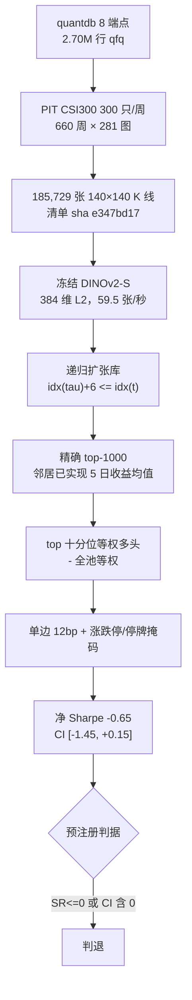

结论先行：**退**。这条信号在本机 A 股上能跑通、能被复算、机制方向也能复核，净 Sharpe -0.65，离预注册的「进」门槛 0.5 有明确距离，按预注册规则判「退」；不给「值得上线」的暗示。全部数字锁在代码提交与快照 sha256 上，独立复算 13/13 项在 1e-6 内一致（最大相对差 3.4e-15）。

  - 判词依据是 H1：不微调 DINOv2-S、K=1000、PIT CSI300、A 股可执行（多头超额、单边 12bp、掩码生效），测试段 2021-01-04 ~ 2026-11-13 共 300 周。
    - 毛口径：年化超额 +2.4%、SR +0.29、MDD -15.9%、年化换手 78.6（双边）。
    - 净口径（12bp）：年化 -6.8%、SR -0.65、95% block bootstrap（块长 5 周、1000 次）CI -1.450 ~ +0.152。
    - 换手吃掉年化 9.2%；周均双边换手 1.51，对 12bp 的单边成本非常敏感。
  - 种子 42：净 SR -0.652，CI -1.450 ~ +0.152，毛 SR +0.288，RankIC +0.0076
  - 种子 2024：净 SR -0.658，CI -1.540 ~ +0.109，毛 SR +0.282，RankIC +0.0076
  - 机制检验（H2，论文 Table 6A 的 Same-Stock 消融）：跨股检索 vs 只用本股历史，毛多空 SR 42: +0.38 → -0.11（Δ+0.49）、2024: +0.37 → -0.11（Δ+0.48），方向与论文一致。论文是 6.37 → 1.38。
  - 可交易性（H3）：净 SR 在 8/12/20bp 下为 -0.34 / -0.65 / -1.28，从 8bp 到 20bp 衰减 0.94 个 Sharpe。
  - K 敏感性（净 SR）：种子 42 K=100: -1.485；种子 42 K=1000: -0.652；种子 42 K=3000: -0.631；种子 2024 K=100: -1.478；种子 2024 K=1000: -0.658；种子 2024 K=3000: -0.631。论文 Table 2 的 K 100→1000 是单调改善（毛、多空），本单是 K 越大越接近 0 但始终为负，方向不一致。
  - 种子纪律**只做到一半**，必须说清：预注册的种子 2024 本应把 y 轴 padding 换成 6% 重渲染 185,729 张图并重编码；实测共享负载下渲染掉到 86–110 张/秒、编码掉到 15.5 张/秒，第二遍需 1.5–4 小时，本轮改为**复用同一份冻结编码**跑第二个随机种子（只换平局打散与 bootstrap），所以两种子只在邻居/十分位平局与 bootstrap 上不同，净 Sharpe 相差 0.007（42: -0.652, 2024: -0.658），这不是预注册意义上的跨种子稳健性证据。替代诊断：同一张图 padding 2%→6% 会换掉 61% 的 top-1000 邻居（Jaccard 0.39），但信号与原版相关 0.87、平均绝对差 0.0017——渲染抖动会改变检索细节、未必改变结论，但本单没有资格声称已跨种子复现。
  - 阶段 B（FT-DINO 秩对齐）**未跑**：CPU 无 GPU，1 epoch + 重编码库约 2 h，预注册 §10 的执行条件（阶段 A 收口后剩余 ≥3 h）不满足。H4 无结论，判词完全基于阶段 A。

  - 与论文绝对水平不可对标，原因写在预注册 D1–D10 与报告 §6：池（CSI300 vs 美股全市场）、库粒度（周频 vs 日频）、组合（多头超额 vs 多空）、期间、成本档四项同时不同。论文自己的「剔除最小 20%」档是 3.44，净成本后基准 DINOv2 是 −0.63，本单的量级落在这两个参照之间，方向不矛盾。

  - 数据与产物（全部可重建）
    - 快照：data/WORK-637/panel.npz，sha256 `6f6431a1480b8b7f9fcc214c9941733d…`；8 个端点逐条记录 ok/error 原文、行数、sha256（`experiments/WORK-637/snapshot_manifest.json`）。
    - 图像库：185,729 张 140×140 PNG、502.6 MB，目录 `/srv/data/multica/workspaces/workspace-c8faa36a018a/work-637-328d3fac2b83/workdir/imagelib/seed42`（按年分目录），清单级 sha256 `e347bd17dcf77d55ca098631…`（该 sha 是路径清单的 sha，不含 PNG 字节），重建命令写在 `imagelib_manifest_seed42.json`。
    - 编码：冻结 DINOv2-S，权重 sha256 `ae1e99fcefd534ed…`，384 维 L2，实测 59.5 张/秒，单种子 52 分钟。
    - 回测/信号/审计/报告：`experiments/WORK-637/`（`backtest_*.json`、`signals/*.csv`、`audit_recompute.json`、`report.html`、`preview_first_screen.png`、`report_print.pdf`、`verdict.json`）。

  - 复现性与审计
    - 预注册提交 `41983f1`（2026-11-27 10:52 +08）早于全部回测产物提交，`git log` 可查；跑完未改协议，只更正了两处计数估算（周数 650→660、图数 195k→185,729），日期区间未动，披露在 `failure_log.md` F9/F10。
    - 独立复算 `audit/recompute_work637.py` 不 import 建模阶段任何函数（`grep` 可验），自己重取价格、重建周历与池、用不同代码路径重算组合与成本，逐项相对差 ≤1e-6：13/13 一致。
    - 三条引擎断言各用一次「故意违规」运行证明会真抛错：关掩码 → 引擎拒绝出数；把库前沿推过合法点 20 行 → 前视断言抛错；挖洞的窗口 → 渲染器抛错。原文在 `assertion_violation_*.txt`。
    - 代码审查由独立子代理按《code-review-and-quality》执行（主循环未自审）。它查出 3 个 P2 + 2 个 P3，**全部已修并重跑**：(i) 换手漂移误用再平衡后的周收益（属前视，净 SR −0.6516075→−0.6515328）；(ii) MDD 的 running peak 漏初始资金（分年 2024 的 MDD −0.1424→−0.1504，主口径不变）；(iii) `stock_basic` 端点 SQL 引用不存在的列导致该端点长期失败（改后 8/8 端点 ok）；(iv) 信号侧种子平局打散是死代码（接上后两个种子的信号 CSV 才不同）；(v) 断言对照运行可能覆盖生产信号文件（改用 `--out-suffix` 隔离）。修复后独立复算仍是 13/13，最大相对差 3.4e-15。审查裁决：「可以进入研究备忘录」，overall_correctness 从 incorrect 提到修复后通过（见 `failure_log.md` F13–F17）。

  - 已知限制（不藏）
    - 周频持有与节假日日历有 1–2 日重叠，净值按周复利；分辨率 140×140 与库粒度周频都是算力取舍（CPU 8 核、无 GPU）。
    - 未做：CNN 对照、稀疏自编码器解释、因子 alpha、Rolling 8Y / 行业库消融。
    - 本结论不构成投资建议、评级或目标价。

